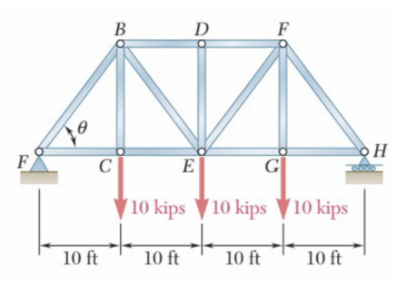
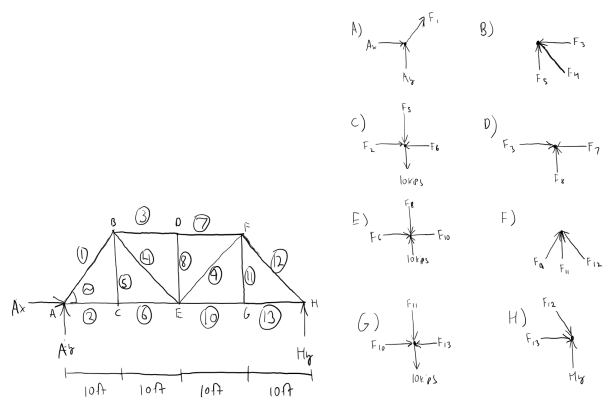
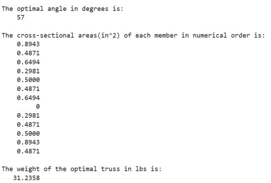

## Truss Optimization Solver

This project is centered around utilizing MATLAB to find the optimal angle and cross-sectional area given the horizontal position of the nodes and the applied forces as shown below.

In order to accomplish this task my partner and I first did hand calculations to understand how to solve for the angle and area of the members using the FBD show below.

Finally we were able to take our hand calculation process and put it into MATLAB code where we were able to get our final results based on the example given earlier, which is shown below. 

[Truss Optimization Solver](../Docs/Ferris_Haber_ME212_StaticsTrussProblem_Report.pdf)
