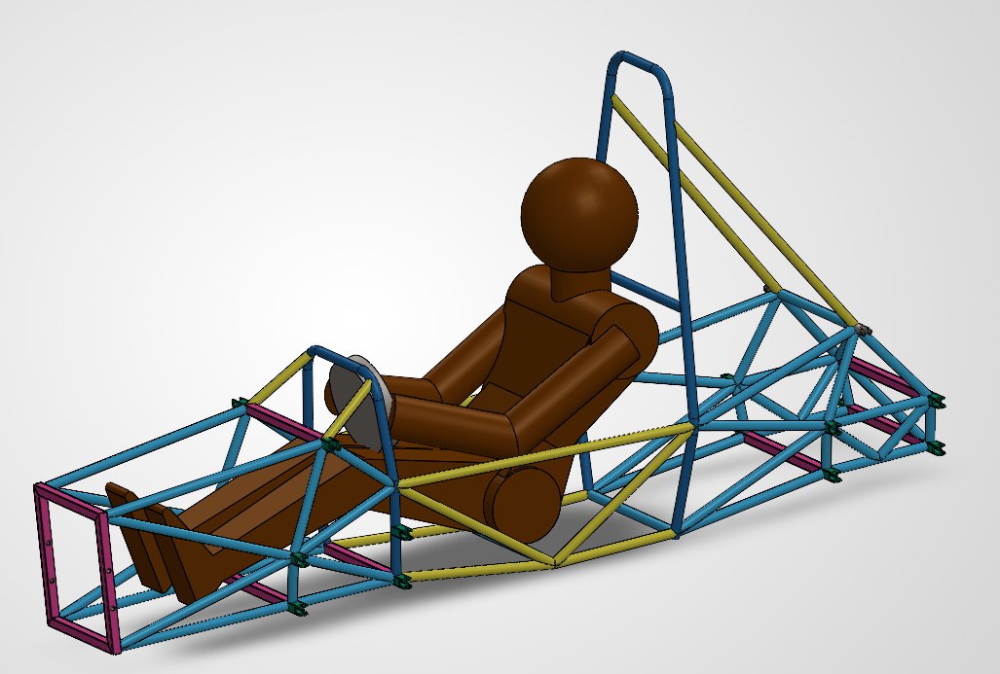
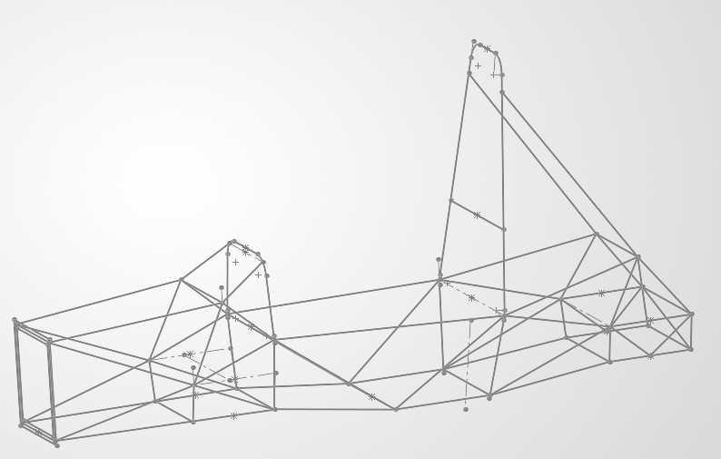
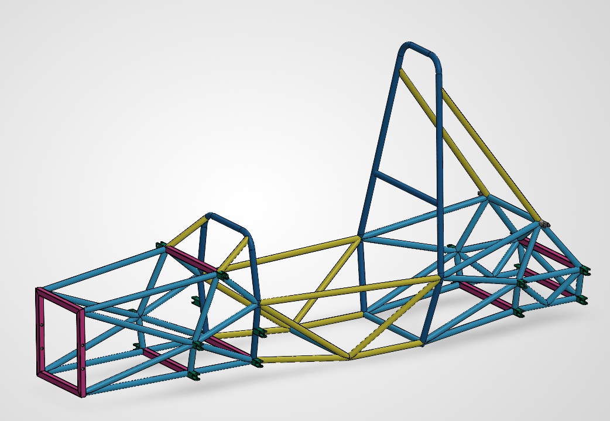
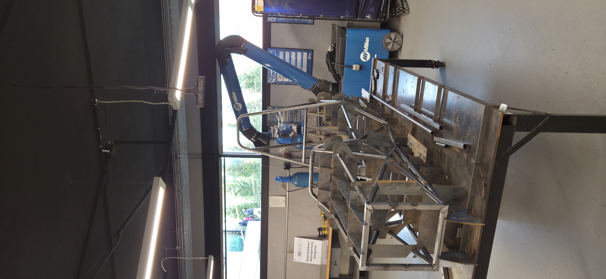

## Formula SAE Chassis

One of my biggest projects has been designing and fabricating a tube chassis for my school's Formula SAE team. Due to various rules changes, switching to internal combustion from an electric powertrain, and multiple years of design without any validation this was quite the undertaking. Fortunately I had the guidance of many of my predecessors to aid me.

The first step of the design process was establishing a 2 dimensional ergonomics model in CAD based on previous driver data. This allowed me to establish the location of both the front and main hoops in such a way that they were as low as possible while meeting all rules and keeping the driver in a comfortable position. Shown below is this 2D model.

The next step was to adapt this into a 3D ergonomics model that can be used to design the frame around so that there is sufficient room to fit the driver. This model is shown below in the frame.

After the 3D ergonomics model was established I was able to start figuring out the shape of the frame. This was done by first creating the front and main hoops based on the 2D ergonomics drawing, then using the 3D ergonomics model I was able to establish the size and shape of the front bulkhead. The next step was placing the suspension hardpoints given to me by our suspension team with offsets to represent the length of tabs. Then I was able to connect all those components and create other required structures including side, front, and rear impact protection as well as front and main hoop braces. Shown below is this 3D sketch which was used to establish where these tubes would go.

Once the shape of the frame was determined I was able to turn the lines into tubes using the weldments tools in SOLIDWORKS. This allowed me to use my own presets to create tubes of various thicknesses, which are specified by the rules, in addition to having the tubes be both square and round tubes. Then using the weldments tools I was able to trim the tubes so that they were either coped or mitered to each other. Shown below is the the outcome of this process.

