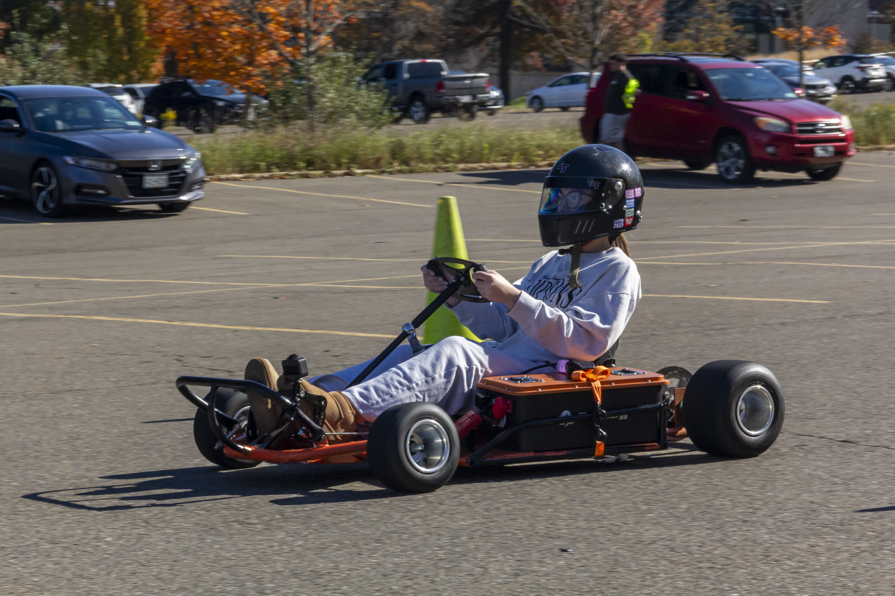

**Hybrid & Electric Go-Karts**

These projects are the cumulative effort of dozens of people in the SAE club at Binghamton University. I was one of the few people to be on this project from start to finish.
As a freshman I started on the drivetrain team where we worked on determining drive ratios, mounting for the brake system, and mounting for the IC engine and electric motor.
The following year I took on a leadership role as the frame lead where I oversaw chassis design and manufacturing. I also assisted with other mechanical work with the electric kart as that was the focus that year.
As a junior I took on the role of president of the club where I oversaw the completion of the hybrid kart, while assisting the drivetrain lead with designing a throttle system to work with both the electric motor and IC engine.

