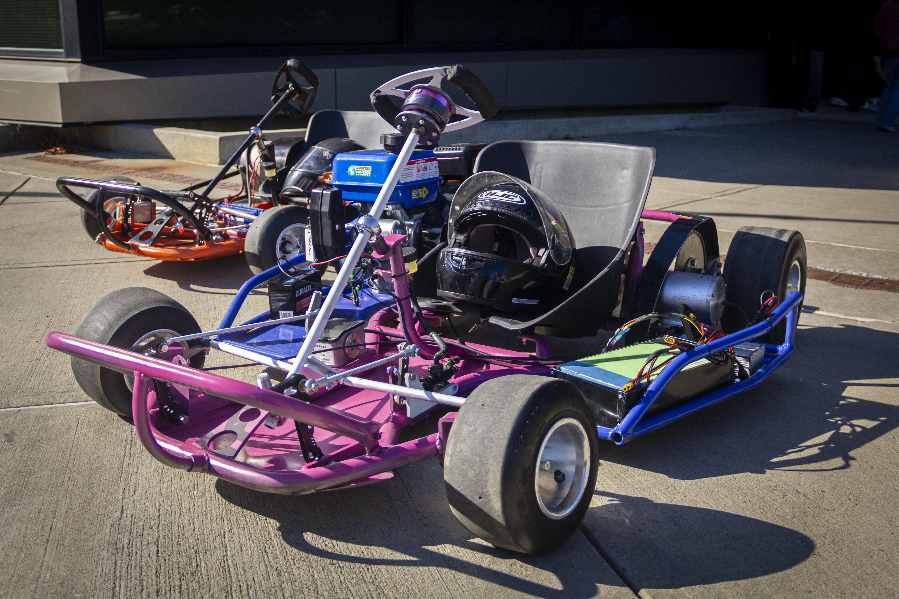
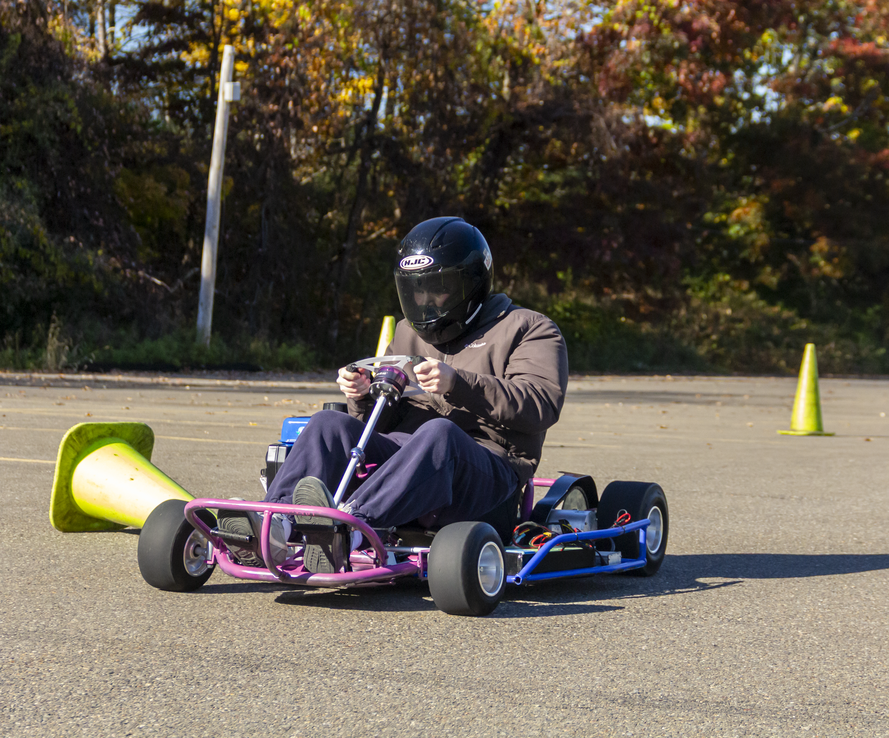

## Hybrid & Electric Go-Karts

These projects are the cumulative effort of dozens of people in the SAE club at Binghamton University. I was one of the few people to be on this project from start to finish.
As a freshman I started on the drivetrain team where we worked on determining drive ratios, mounting for the brake system, and mounting for the IC engine and electric motor.
The following year I took on a leadership role as the frame lead where I oversaw chassis design and manufacturing. I also assisted with other mechanical work with the electric kart as that was the focus that year.
As a junior I took on the role of president of the club where I oversaw the completion of the hybrid kart, while assisting the drivetrain lead with designing a throttle system to work with both the electric motor and IC engine.

This is the EV go-kart. It boasts a 5KW electric motor with a 36V 105Ah LiFePo4 battery with a maximum output amperage of 400A. The gear ratio combined with the maximum RPM of the motor gives a top speed of 72 mph which is limited to lower, safer speeds to comply with campus speed limits of 25mph via the motor controller. 

This is the Hybrid go-kart. It utilizes both a 2KW electric motor and a 6.5 HP IC engine that can run on either regular pump gas or liquid propane. The theoretical top speed of the hybrid go-kart is 37.1 mph  
